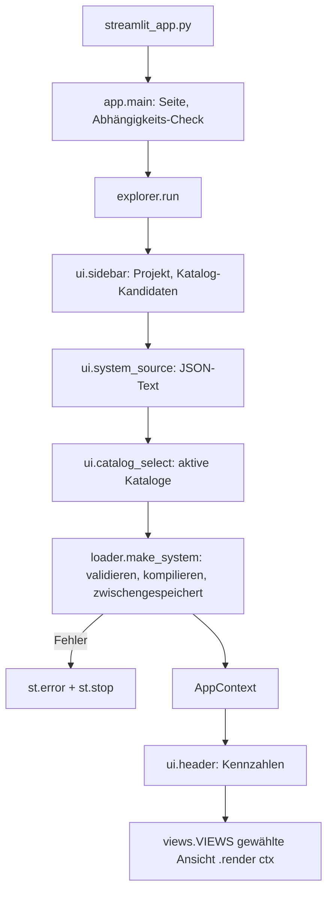

# Architektur

## Grundsätze

1. **Nur öffentliche API.** Der Explorer importiert ausschließlich `raytatouille` (und `analysis`,
   `plot`). Fehlt etwas, wird es in der Bibliothek beantragt, nicht umgangen ([ADR 0002](adr/0002.md)).
2. **Reine Logik getrennt von Oberfläche.** Alles, was sich ohne Streamlit und ohne Bibliothek testen
   lässt, liegt in eigenen Modulen ([ADR 0003](adr/0003.md)).
3. **Eine Ansicht = eine Funktion `render(ctx)`.** Ansichten lesen nur aus dem `AppContext`.

## Ablauf eines Laufs

Streamlit führt das Skript bei jeder Eingabe komplett neu aus.

## Module

| Modul | Aufgabe | braucht Bibliothek |
| --- | --- | --- |
| `builder` | Flächentabelle zu `.rtt.json`, Vorlagen, deutsche Fehlertexte | nein |
| `catalogs` | AGF/Coating lesen, Referenzen finden, Kataloge automatisch wählen | nein |
| `repo`, `colors`, `stretch` | Repo-Suche, Spektralfarben, Streamlit-Breitenschalter | nein |
| `messages` | Diagnosen mit Code und Flächenname, Tabelle verlorener Strahlen | nein |
| `model_table` | Modellbaum (`System.root`) als Tabellenzeilen | nein |
| `optim_table` | Merit-Funktion, Variablen und Optimierungsstatus als Tabellenzeilen | nein |
| `diffraction` | Anzeige-Näherungen (Airy-Radius, Rayleigh-Tiefe), Radien, Fokuslagen, Zernike-Namen | nein |
| `pupil_points` | Pupillenpunkt-Listen lesen, nächster Strahl zu einem Punkt, Text von Jones-Matrixelementen | nein |
| `layout_geometry` | Lage ebener Flächen im Schnitt, Strahlstücke nach dem letzten Ereignis eines Pfads | nein |
| `layout_zoom` | Zoom-Fenster der Layout-Zeichnung: Prüfung eines Ausschnitts, Fenster um die Quelle und vor der Bildebene, Startpunkt und Bildebene aus den Strahlen | nein |
| `compat` | `Features`: erkennt optionale Funktionen der Bibliothek | ja |
| `loader` | `make_library`, `make_coatings`, `make_system` mit `st.cache_resource` | ja |
| `drawing`, `rays` | Linsenschnitt zeichnen, freies kollimiertes Bündel | ja |
| `context` | `AppContext`, Beschriftungen, Strahlquelle | ja |
| `ui/*` | Seitenleiste, Systemquelle, Katalogwahl, Kopfzeile | ja |
| `views/*` | Analyseansichten, Register `VIEWS` | ja |

## Zwischenspeicher und Zustand

- `make_system` ist zwischengespeichert; Schlüssel sind JSON-Text, Katalogbytes, Coatingbytes,
  Temperatur, Druck und die Konfiguration. Fehler kommen als Text im Ergebnis zurück, nie als Exception.
- `st.session_state` wird nur vom Systembaukasten und der Kopfzeile benutzt: `preset`,
  `loaded_preset`, `bdf` (Tabelle), `bver` (Version des Editors), `bedited`, `focus_shift`,
  `glass_options`, `picker_row`, `picker_glass`, `bmerit` (Anfangsinhalt der Merit-Tabelle). Ändert
  ein Knopf die Tabelle, erhöht er `bver`,
  damit der Editor neu aufgebaut wird.
- Die Optimierung benutzt `optim_result` (letztes Ergebnis mit seinen Eingaben) und
  `optim_override` (übernommenes System mit Quelle und Ausgangstext). `explorer.run` setzt bei jedem
  Lauf `optim_source` und `optim_base` und verwirft `optim_override`, sobald sich Quelle oder
  Ausgangstext ändern.
- Widget-Schlüssel der Wellenfront- und Beugungsansicht: `opd_focus`, `opd_terms` und `diff_*`
  (`diff_field`, `diff_wl`, `diff_grid`, `diff_focus`, `diff_kind`, `diff_psf_log`, `diff_psf_zoom`,
  `diff_psf_zoom_rel`, `diff_ee_centre`, `diff_tf_factor`, `diff_tf_range`, `diff_tf_steps`).
- Weitere Widget-Schlüssel ab 0.8: `jones_grid`, `jones_basis` (Polarisation), `fringe_rings` (Pfade &
  Ghosts), `bundle_points` (Strahlenbündel), `layout_all_paths` (Layout).
- Layout-Ausschnitt: `layout_view_mode` (`all`, `source`, `image`, `box`), `layout_view_box` (letzter
  Ausschnitt) und die Widget-Schlüssel `layout_view_all`, `layout_view_source`, `layout_view_image`,
  `layout_view_apply`, `layout_zoom_half`, `layout_zoom_image_width`, `layout_zoom_z0`,
  `layout_zoom_z1`, `layout_zoom_l0`, `layout_zoom_l1`. Der frühere Haken „Auf die Bildebene zoomen“ und
  sein Schieberegler sind durch den Knopf `layout_view_image` und das Feld `layout_zoom_image_width`
  ersetzt.
- Widget-Schlüssel der Katalogauswahl enthalten Quelle und Referenzen, damit die Vorauswahl bei
  einem Systemwechsel neu berechnet wird.
- Strahlquelle (`ui.ray_source`, je Ansicht ein `key`): `src_{key}_{can_aim}` (Pupille oder freies
  Bündel), `src_r_{key}`, `src_z_{key}`, `src_tx_{key}`, `src_ty_{key}`. `src_defaults_{key}` merkt sich
  die Vorgaben für Radius und Startebene; ändern sie sich (anderes System), werden `src_r_{key}` und
  `src_z_{key}` verworfen. Die Neigungen bleiben.

## Neue Ansicht hinzufügen

1. `views/meine_ansicht.py` mit `TITLE = "..."` und `render(ctx: AppContext) -> None` anlegen.
2. In `views/__init__.py` importieren und in `_MODULES` an der gewünschten Stelle eintragen.
3. Rechnet sie etwas, das ohne Streamlit testbar ist, gehört das in ein reines Modul mit Unit-Test.
4. Rauchtest: Ansicht in `VIEWS` von `tests/test_app.py` eintragen.
5. Braucht sie eine optionale Bibliotheksfunktion: Flag in `compat.Features` ergänzen und die
   Ansicht bei fehlender Funktion mit `st.info` erklären statt abzustürzen.
